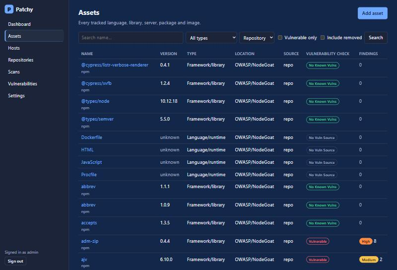
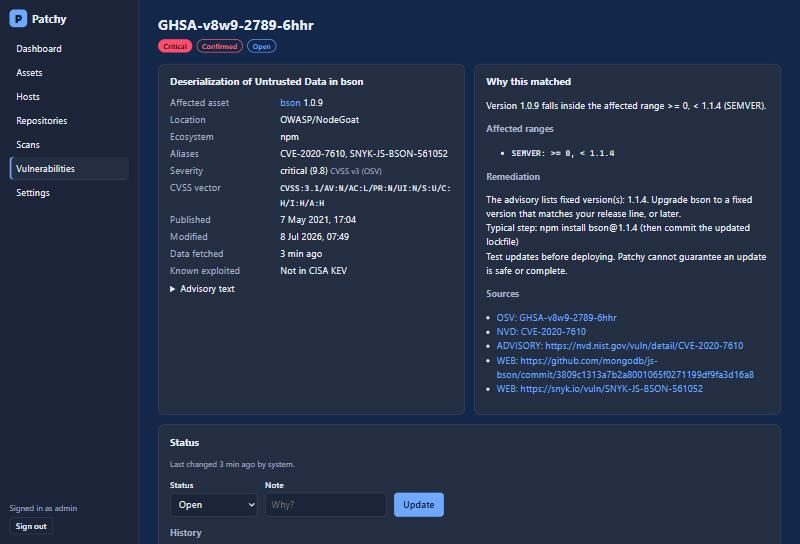
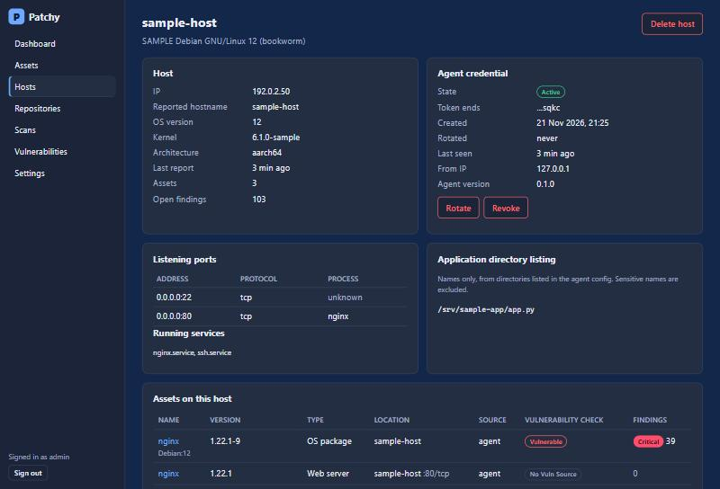

# Patchy

Self-hosted software inventory and vulnerability tracker for a home lab. Register software by hand, discover it from GitHub repositories and Linux hosts, match it against OSV, CISA KEV and (optionally) NVD, and get sourced remediation guidance.


<br>

## Contents

- [Features](#features)
- [Quick start](#quick-start)
- [Configuration](#configuration)
- [First administrator](#first-administrator)
- [Scanning GitHub repositories](#scanning-github-repositories)
- [Linux agent](#linux-agent)
- [Vulnerability feeds](#vulnerability-feeds)
- [How matching works](#how-matching-works)
- [API](#api)
- [Development and tests](#development-and-tests)
- [Backups](#backups)
- [Troubleshooting](#troubleshooting)
- [Known limitations](#known-limitations)
- [Security notes](#security-notes)

<br>

## Features

- **Inventory**: languages, libraries, web servers, databases, OS packages, container images and other software, with versions, hosts, IPs, ports, paths, repositories and notes. Search, filter, edit and delete.
- **GitHub discovery**: reads manifests and lockfiles through the GitHub API. Nothing is cloned, built or executed.
- **Linux agent**: one read-only Python script on a systemd timer. It sends reports outbound over HTTPS using a revocable per-host token.
- **Vulnerabilities**: OSV matching with evidence, CISA KEV flags, optional NVD scores, fixed versions and remediation steps taken from the advisory.
- **Honest states**: confirmed, possible and version-unknown matches are kept separate. "Not checked" and "stale feed" are never shown as clean.
- **Workflow**: open, acknowledged, resolved and false-positive states with notes. Findings auto-resolve when the version moves out of range and reopen if it moves back.
- **Audit log** of logins, asset changes, scans, agent enrolment and revocation, and status changes.

| Assets | Finding detail | Host and agent |
|---|---|---|
|  |  |  |

<br>

## Quick start

Requires Docker with Compose v2. Images build on amd64 and arm64 (Raspberry Pi 4/5).

```bash
git clone https://github.com/pqpxo/patchy.git
cd patchy
cp .env.example .env
# Set a database password:
sed -i "s/^POSTGRES_PASSWORD=.*/POSTGRES_PASSWORD=$(openssl rand -hex 24)/" .env
docker compose up -d --build
docker compose exec app python -m app.cli create-admin
```

Open `http://<host>:8080` and sign in.

> [!IMPORTANT]
> `COOKIE_SECURE=true` (the default) needs HTTPS. Behind Nginx Proxy Manager or Caddy, keep it `true`. If you browse straight to `http://<lan-ip>:8080`, set `COOKIE_SECURE=false` in `.env`, otherwise sign-in appears to do nothing. `http://localhost` works either way.

| Service | Purpose | Port |
|---|---|---|
| `app` | API and web UI (uvicorn), runs migrations on start | `PORT` (8080) |
| `worker` | Repository scans and feed refreshes | none |
| `db` | PostgreSQL 16 | not published |

Data lives in `./data/postgres` and survives `docker compose down` followed by `docker compose up -d --build`.

**Upgrading:** `git pull && docker compose up -d --build`. Migrations run automatically when `app` starts.

<br>

## Configuration

All settings are environment variables in `.env`. See [.env.example](.env.example) for the full list.

| Variable | Default | Notes |
|---|---|---|
| `PORT` | `8080` | Listen and publish port |
| `POSTGRES_PASSWORD` | none | Required. Alphanumeric (it goes into a URL) |
| `COOKIE_SECURE` | `true` | `false` only for plain-HTTP LAN access |
| `SESSION_HOURS` | `12` | Session lifetime |
| `FORWARDED_ALLOW_IPS` | `127.0.0.1` | Reverse proxy IP(s) trusted for `X-Forwarded-For` |
| `GITHUB_TOKEN` | empty | Private repos and 5000 requests/h. Never sent to the browser |
| `OSV_ENABLED` / `KEV_ENABLED` / `NVD_ENABLED` | `true` / `true` / `false` | Feed switches |
| `NVD_API_KEY` | empty | Optional, raises the NVD rate limit |
| `FEED_REFRESH_HOURS` | `24` | Automatic full refresh interval, `0` = manual only |
| `FEED_STALE_HOURS` | `72` | After this, results are flagged stale |
| `OSV_MAX_*`, `NVD_MAX_PER_REFRESH` | see example | Hard caps on requests per refresh |
| `REPO_MAX_FILE_BYTES` / `REPO_MAX_TOTAL_BYTES` / `REPO_MAX_MANIFESTS` / `REPO_SCAN_TIMEOUT_SECONDS` | 5 MB / 50 MB / 300 / 180 | Repository scan limits |
| `ENABLE_API_DOCS` | `false` | Swagger UI at `/api/docs` (loads from a CDN) |

> [!TIP]
> Behind Nginx Proxy Manager, set `FORWARDED_ALLOW_IPS` to the proxy's IP (or its Docker network gateway). Otherwise every request appears to come from the proxy, which skews rate limits and the audit log.

<br>

## First administrator

Patchy has a single administrator account and ships no default password.

```bash
docker compose exec app python -m app.cli create-admin            # prompts for a password (12+ chars)
docker compose exec app python -m app.cli reset-password          # forgot it; signs out all sessions
```

You can change the password later under **Settings**.

Optional demo data, clearly labelled DEMO:

```bash
docker compose exec app python -m app.cli seed-demo
docker compose exec app python -m app.cli clear-demo
```

<br>

## Scanning GitHub repositories

Go to **Repositories**, paste `https://github.com/owner/repo`, optionally add a branch, and choose **Add and scan**. Progress shows on the page and under **Scans**.

What happens:

1. Patchy resolves the branch to a commit SHA and records it, so every component links to an exact revision.
2. It lists the tree through the GitHub API and fetches only recognised files, each capped by size. Nothing is written to disk, so there is no archive to extract and no path traversal.
3. Parsers read the files as data. No code, build scripts, package hooks or containers run. XML with `DOCTYPE` or `ENTITY` declarations is refused.

Supported files:

| Ecosystem | Exact versions from | Constraints only from |
|---|---|---|
| npm | `package-lock.json`, `npm-shrinkwrap.json`, `yarn.lock`, `pnpm-lock.yaml` | `package.json` |
| PyPI | `poetry.lock`, `uv.lock`, `Pipfile.lock`, `==` pins in `requirements*.txt` | `pyproject.toml`, other requirements |
| Go | `go.mod` (`go.sum` is recorded as a manifest only) | |
| crates.io | `Cargo.lock` | `Cargo.toml` |
| Packagist | `composer.lock` | `composer.json` |
| Maven | `pom.xml` (literal and `${property}` versions), `build.gradle(.kts)`, `gradle.lockfile` | version ranges |
| RubyGems | `Gemfile.lock` | |
| Inventory only | `Dockerfile` and compose `image:` tags, `.nvmrc`, `.python-version`, `.tool-versions`, `runtime.txt`, nginx/Apache/Caddy config files, GitHub language stats | |

A lockfile in the same folder takes precedence over its manifest's looser constraints. Vendored `node_modules/` and `vendor/` trees are skipped.

**Private repositories:** set `GITHUB_TOKEN` to a fine-grained token with read-only *Contents* and *Metadata* on the repos you want. The token stays server-side and is stripped from any stored error text.

<br>

## Linux agent

The agent is one Python 3.8+ file using only the standard library ([agent/patchy_agent.py](agent/patchy_agent.py)). It runs every 6 hours from a systemd timer as an unprivileged `patchy-agent` user and POSTs a JSON report to Patchy. It never listens on a port and never takes commands from the server.

### Enrol a host

1. In Patchy, go to **Hosts**, add the host, then choose **Create agent credential**. Copy the token; it is shown once.
2. On the host, download the files from your portal, read them, and install:

```bash
mkdir patchy-agent && cd patchy-agent
for f in patchy_agent.py install.sh uninstall.sh config.example.json; do curl -fsSO https://patchy.example.lan/api/agent/files/$f; done
less patchy_agent.py install.sh
sudo sh install.sh https://patchy.example.lan
```

The installer prompts for the token (input hidden, kept out of shell history), writes `/etc/patchy-agent/config.json` and `/etc/patchy-agent/token` (mode 0640, `root:patchy-agent`), installs a hardened service and timer, checks the credential and sends a first report.

> [!TIP]
> Try it without touching a real host first:
> `python3 patchy_agent.py --sample` prints a synthetic SAMPLE report, `--dry-run` prints the real report without sending it, `--check` tests the URL and token, and `--sample --send` pushes the sample to the portal.

### What it collects

| Item | Source | Switch in `config.json` |
|---|---|---|
| OS, kernel, arch, hostname, primary IP | `/etc/os-release`, `uname`, a routing lookup (no packet sent) | always |
| Installed packages | `/var/lib/dpkg/status`, `/lib/apk/db/installed` or `rpm -qa` | `collect.packages` |
| Listening TCP/UDP sockets | `/proc/net/*`; process names only where readable | `collect.listening_ports` |
| Running services | `systemctl list-units --state=running` | `collect.services` |
| Versions of common software | fixed allowlist (`nginx -v`, `python3 --version`, `openssl version`...) | `collect.version_probes` |
| Running container images | `docker ps` (needs the docker group, see below) | `collect.docker_images` (off) |
| File and folder **names** under chosen app directories | `os.scandir`, no symlink following, depth and count limits | `app_dirs` (empty) |

It never reads file contents, environment variables, keys, passwords, tokens or shell history. Sensitive names (`.ssh`, `.env`, `*.key`, `*.pem`, `id_*`, `shadow`, `.git`, ...) are skipped by the agent and dropped again by the server. Broad roots such as `/`, `/home`, `/etc` and `/var` are refused. Commands run from a fixed allowlist as argument lists, with no shell, a clean environment, a timeout and capped output.

```json
"app_dirs": [{ "path": "/opt/myapp", "max_depth": 3, "max_files": 1000 }]
```

### Permissions and network

- Runs as `patchy-agent` with `NoNewPrivileges`, an empty capability set, `ProtectSystem=strict`, `ProtectHome=yes` and `PrivateTmp`.
- Outbound HTTPS to your portal only. Redirects are refused so the token can't be forwarded elsewhere. For a self-signed certificate set `ca_file`. For a trusted LAN without TLS set `"allow_insecure_http": true`.
- To list an app directory under `/home`, add a drop-in: `sudo systemctl edit patchy-agent` with `[Service]` and `ProtectHome=read-only`.
- `docker_images` needs `SupplementaryGroups=docker` in a drop-in. Docker group membership is equivalent to root, so only enable it if you accept that.
- Because it runs unprivileged, it can't see the processes behind other users' sockets, and those show as "unknown". That is deliberate.

### Rotate, upgrade, remove

- **Rotate:** on the host page choose **Rotate**. The old token stops working at once. Put the new one in `/etc/patchy-agent/token`.
- **Revoke:** choose **Revoke**. Reports are rejected with HTTP 401.
- **Upgrade:** download the new `patchy_agent.py` and `install.sh` and run `sudo sh install.sh` again. The config and token are kept.
- **Remove:** `sudo sh uninstall.sh`, then revoke the credential in Patchy.
- **Logs:** `journalctl -u patchy-agent`. **Run now:** `sudo systemctl start patchy-agent`.

Debian, Raspberry Pi OS and Ubuntu packages are matched against OSV's distro advisories by **source** package (for example `libssl3` maps to `openssl`). Alpine, Rocky and Alma are queried too. Other RPM distros are inventory only.

<br>

## Vulnerability feeds

| Source | Used for | Limits | Config |
|---|---|---|---|
| [OSV.dev](https://osv.dev) | Advisories, affected ranges, fixed versions | No key. Batches of up to 1000 queries, then one fetch per advisory (4 in parallel) | `OSV_*` |
| [CISA KEV](https://www.cisa.gov/known-exploited-vulnerabilities-catalog) | Known-exploited flag, CISA due date and required action | One JSON download per full refresh | `KEV_ENABLED` |
| [NVD](https://nvd.nist.gov/developers) | CVSS score where OSV has none | 5 requests/30 s, or 50 with `NVD_API_KEY`. Patchy paces itself and caps at `NVD_MAX_PER_REFRESH` | `NVD_*` |

- A **full refresh** runs every `FEED_REFRESH_HOURS` and from **Refresh now** on the dashboard or Settings (at most 6 an hour).
- After any scan or asset change, a small **pending refresh** checks only the new package versions. It doesn't move the "last updated" time.
- Each source records its last attempt, last success and last error. If OSV fails or goes stale, every page says so, and components show "Not checked yet" or "Feed stale" instead of a clean result.

<br>

## How matching works

The logic lives in [backend/app/matching.py](backend/app/matching.py) and has no database or network code.

1. OSV is queried with the exact ecosystem, package and version. Results narrow the candidate advisories.
2. Patchy evaluates each advisory's OSV ranges itself, using PEP 440 (PyPI), SemVer (npm, Go, crates.io) and dpkg ordering (Debian, Ubuntu). A distro advisory for `Debian:11` never matches a `Debian:12` host.
3. The result is one of:

| Match | Meaning |
|---|---|
| **Confirmed** | Version is inside an affected range or listed explicitly, or OSV's own version-aware query says so for ecosystems Patchy can't compare locally (Maven, Packagist, RubyGems, Alpine, RPM) |
| **Possible** | The package matches but the version couldn't be compared, or OSV and the local check disagree |
| **Version unknown** | The package matches but only a constraint, or no version, is recorded |

Names must match exactly after ecosystem normalisation (PEP 503 for PyPI). A similar name is never a match. Remediation uses only the advisory's `fixed` events and links. If none are listed, Patchy says so rather than guessing.

<br>

## API

JSON over `/api`. The OpenAPI schema is at `/api/openapi.json`, and Swagger UI is at `/api/docs` when `ENABLE_API_DOCS=true`.

| Area | Endpoints |
|---|---|
| Auth | `POST /api/auth/login`, `POST /api/auth/logout`, `GET /api/auth/me`, `POST /api/auth/password` |
| Assets | `GET/POST /api/assets`, `GET/PUT/DELETE /api/assets/{id}` |
| Hosts and agents | `GET/POST /api/hosts`, `GET/PUT/DELETE /api/hosts/{id}`, `POST /api/hosts/{id}/agent`, `.../agent/rotate`, `.../agent/revoke` |
| Repositories | `GET/POST /api/repositories`, `GET/DELETE /api/repositories/{id}`, `POST /api/repositories/{id}/scan` |
| Scans | `GET /api/scans`, `GET /api/scans/{id}` |
| Findings | `GET /api/findings`, `GET /api/findings/{id}`, `POST /api/findings/{id}/status` |
| Feeds and dashboard | `GET /api/feeds`, `POST /api/feeds/refresh`, `GET /api/dashboard`, `GET /api/settings`, `GET /api/audit` |
| Agent (bearer token) | `GET /api/agent/ping`, `POST /api/agent/report` |

Lists take `page` and `page_size` (max 200) and return `{items, total, page, page_size}`. Writes from the browser need the `X-CSRF-Token` header returned by `/api/auth/me`. Times are UTC ISO 8601. Re-sending an agent report with the same `report_id` returns the original scan, and a repeated scan request returns the queued one.

<br>

## Development and tests

```bash
python -m venv .venv && .venv/bin/pip install -r backend/requirements.txt pytest
cd backend && ../.venv/bin/python -m pytest -q          # 102 tests, SQLite, no network
cd ../frontend && npm ci && npm test && npm run build    # vitest, tsc, vite build
```

Tests cover version comparison and range edge cases, ecosystem and distro separation, unknown versions, every parser, unsafe repo paths, XML entity refusal, mocked GitHub and feed runs (including failures), auth, CSRF, rate limiting, input validation, agent token rotation and revocation, report idempotency and size limits, sensitive path filtering, agent directory safety, and migration and model parity.

For local development without Docker, run `alembic upgrade head` and `uvicorn app.main:app --port 8080` in `backend/`, `python -m app.worker` in another terminal, and `npm run dev` in `frontend/` (proxies `/api` to port 8080). The default database is SQLite at `backend/data/patchy.db`.

<br>

## Backups

Everything lives in PostgreSQL. A nightly dump is enough:

```bash
docker compose exec -T db pg_dump -U patchy patchy | gzip > patchy-$(date +%F).sql.gz
```

Restore into a fresh stack with `gunzip -c file.sql.gz | docker compose exec -T db psql -U patchy patchy`. Keep `.env` safe too. Agent tokens are stored only as hashes, so after a restore from an older backup you may need to rotate them.

<br>

## Troubleshooting

| Symptom | Fix |
|---|---|
| Sign-in does nothing | You're on plain HTTP with `COOKIE_SECURE=true`. Use HTTPS or set it to `false` |
| Repo scan: "not found" | Private repo or wrong branch. Set `GITHUB_TOKEN` |
| Repo scan: 403 rate limit | Unauthenticated GitHub allows 60 requests/h. Add `GITHUB_TOKEN` |
| Everything shows "Not checked yet" | The worker isn't running or OSV is unreachable. See `docker compose logs worker` and the Settings feed panel |
| Agent: HTTP 401 | Token revoked, rotated or mistyped. Re-check `/etc/patchy-agent/token` |
| Agent: "refusing plain http" | Use HTTPS or set `allow_insecure_http` |
| Agent: OS packages show "No vuln source" | This distro has no OSV mapping in Patchy (see limitations) |
| Audit log shows the proxy's IP | Set `FORWARDED_ALLOW_IPS` |

<br>

## Known limitations

- Version comparison is done locally only for PyPI, npm, Go, crates.io, Debian and Ubuntu. Maven, Packagist, RubyGems, Alpine, Rocky and Alma rely on OSV's server-side version match. NuGet has no parser yet.
- Container images, language runtimes, web-server configs and agent version probes are inventory only. Patchy doesn't scan image layers, and OSV has no feed for e.g. an nginx built from source.
- Without a lockfile, npm/PyPI/Cargo/Composer dependencies are constraints, shown as version unknown.
- `go.sum` and Gradle files with variables or version catalogs aren't resolved.
- GitHub truncates trees over about 100,000 entries. The scan says so when it happens.
- Rate limits are per process (single uvicorn worker by design).
- Very large distro advisory sets (e.g. the Linux kernel) are capped per package by `OSV_MAX_VULNS_PER_PACKAGE`. Capped queries are marked truncated.
- Swagger UI needs a CDN. The JSON schema doesn't.

<br>

## Security notes

> [!WARNING]
> Patchy is built for a trusted home lab. Put it behind HTTPS and don't expose it to the internet without extra protection (VPN, SSO in front of the proxy, or IP allow-listing).

- One admin, scrypt password hashing, HttpOnly + SameSite=Strict session cookies, CSRF token on every write, login rate limiting, generic login errors.
- Strict CSP (`default-src 'self'`, no inline scripts), no CDN assets, frame denial, no CORS.
- Parameterised SQL via SQLAlchemy. Validation errors never echo submitted values. Advisory and repo text renders as text, and only `http(s)` links are made clickable.
- Agent tokens: 256-bit random values, stored as SHA-256 hashes, shown once, revocable and rotatable. Failed agent auth is rate limited.
- Secrets (`GITHUB_TOKEN`, `NVD_API_KEY`) live only in `.env`. They are never returned by the API, never logged, and scrubbed from stored errors.
- Containers run as non-root with read-only filesystems, no Linux capabilities and `no-new-privileges`. The database isn't published.
