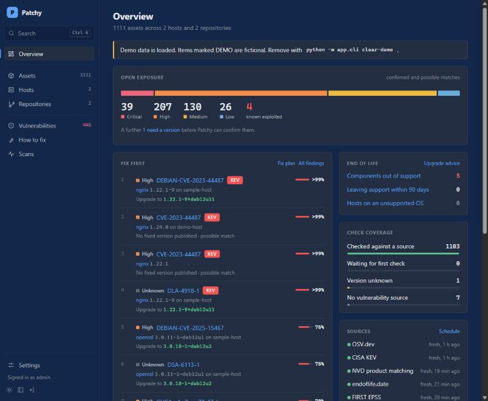
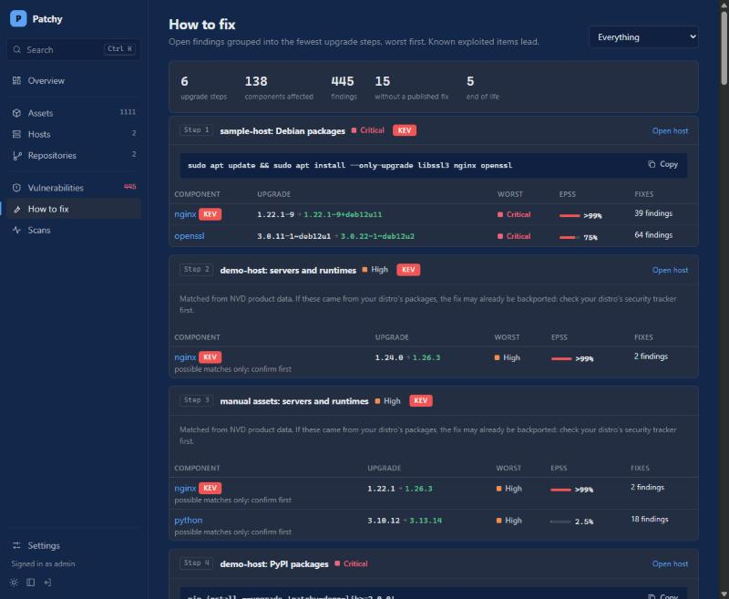
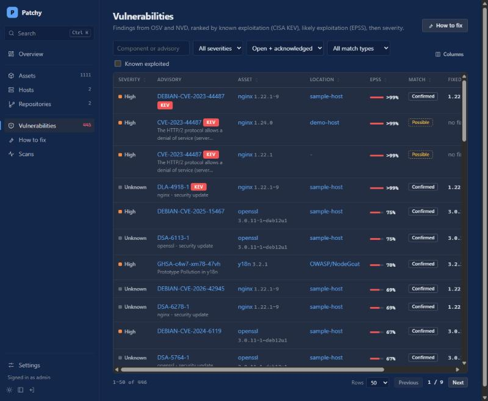
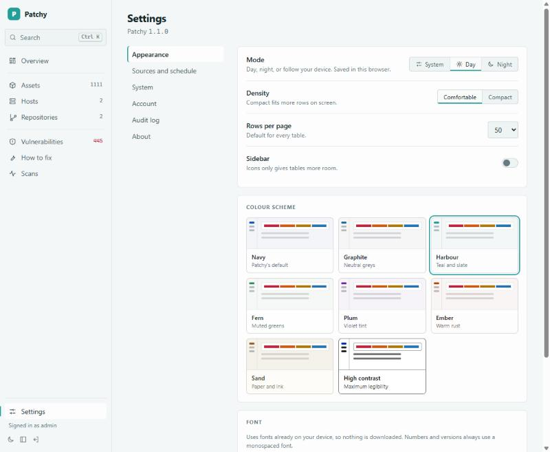

<p align="center">
  
</p>

<h1 align="center">Patchy</h1>

<p align="center">
  Self-hosted software inventory and vulnerability tracker for a home lab.
  Register software by hand, discover it from GitHub repositories and Linux hosts,
  match it against OSV, NVD and CISA KEV, rank by EPSS exploit likelihood,
  track end-of-life dates, and get a step-by-step fix plan.
</p>

<p align="center">
  <a href="https://demo.swakes.codes"><b>Demo</b></a>
</p>

<br>

<p align="center">
  
</p>

<br>

## Contents

- [Features](#features)
- [Quick start](#quick-start)
- [Configuration](#configuration)
- [First administrator](#first-administrator)
- [Scanning GitHub repositories](#scanning-github-repositories)
- [Linux agent](#linux-agent)
- [Vulnerability feeds](#vulnerability-feeds)
- [Fixes](#fixes)
- [Fix-by deadlines](#fix-by-deadlines)
- [Accepted risk](#accepted-risk)
- [Alerts](#alerts)
- [Home Assistant](#home-assistant)
- [Themes and views](#themes-and-views)
- [How matching works](#how-matching-works)
- [API](#api)
- [Development and tests](#development-and-tests)
- [Backups](#backups)
- [Troubleshooting](#troubleshooting)
- [Known limitations](#known-limitations)
- [Security notes](#security-notes)

<br>

## Features

- **Inventory**: languages, libraries, web servers, databases, OS packages, container images and other software, with versions, hosts, IPs, ports, paths, repositories and notes. Search, filter, edit and delete.
- **GitHub discovery**: reads manifests and lockfiles through the GitHub API. Nothing is cloned, built or executed.
- **Linux agent**: one read-only Python script on a systemd timer. It sends reports outbound over HTTPS using a revocable per-host token, lists Docker containers and software added to the base OS, can scan the packages inside container images, and can be asked to rescan from the host page.
- **Pending updates**: each apt host's Updates tab lists what `apt-get upgrade` would install, which are security updates, how many open findings each one fixes, and whether a reboot is waiting. If you allow it on the host, **Run upgrade** runs `apt-get update && apt-get upgrade` there and shows apt's output.
- **Vulnerabilities**: OSV matching with evidence, NVD product (CPE) matching for servers and runtimes, CISA KEV flags, FIRST EPSS exploit likelihood, NVD scores, fixed versions and remediation taken from the advisory.
- **End of life**: support dates from endoflife.date for runtimes, frameworks, servers and host operating systems.
- **Security news**: the 5 newest posts from security news feeds (RSS or Atom) on the Overview. The Hacker News by default; choose your own under **Settings > Sources and schedule** (or `NEWS_FEEDS`).
- **Fixes**: open findings grouped into the fewest upgrade steps per host, repository and manifest, with a copy-paste command where it's safe to give one.
- **Exposure ranking**: findings in software that listens on the network, or in a container that publishes a port, rank above ones nothing can reach. Findings in packages no running program comes from rank lower, and ones in installed kernels that aren't booted are set aside.
- **Trend**: open findings over the last 90 days on the Overview, with the change over 30 days. Hover for each day's critical and high counts.
- **Export**: findings as CSV (with the current filters) from Vulnerabilities or a Findings tab, and a CycloneDX 1.5 SBOM with open vulnerabilities for a host (on its Reports tab), a container image or a repository. Every export is audit-logged.
- **Newer images** (optional, off by default): flags containers whose tag now points at a newer build on Docker Hub, GHCR, Quay or another public registry.
- **Home Assistant sensors**: read-only API tokens and a summary endpoint, with ready-made `rest:` sensors for open, critical, known-exploited and network-exposed findings, end of life, hosts not reporting and newer images.
- **GitHub Dependabot**: cross-checks each repository's Dependabot alerts against Patchy's own findings.
- **Per-source schedules**: switch each source on or off and choose how often it refreshes, from Settings.
- **Interface**: 18 colour schemes with day and night modes, 6 font styles, compact density, sortable tables with a column chooser, quick search (Ctrl+K). Version and changelog in Settings.
- **Honest states**: confirmed, possible and version-unknown matches are kept separate. "Not checked" and "stale feed" are never shown as clean.
- **Workflow**: open, acknowledged, resolved and false-positive states with notes. Findings auto-resolve when the version moves out of range and reopen if it moves back. Findings that Debian rates *unimportant* or Ubuntu rates *negligible* are set aside as **minor**, so they don't fill your counts. Accepted-risk rules set findings aside until a date you choose.
- **Fix-by deadlines**: days per severity (7, 30, 90 and 180 by default), an overdue count and filter, a due date on every open finding, an optional overdue alert, and how quickly findings were fixed over the last 90 days.
- **AI fix prompts**: a ready-made prompt and a downloadable report per host or repository, to get step-by-step patching help from ChatGPT or Claude.
- **Alerts**: one message to a webhook (Home Assistant), ntfy, Pushover or email when an exploited or critical vulnerability is found, a host stops reporting, or software nears end of life. An optional weekly digest sums up the week.
- **Audit log** of logins, asset changes, scans, agent enrolment and revocation, and status changes.

| Fixes | Vulnerabilities |
|---|---|
|  |  |
| **Host and agent** | **Themes (Harbour, day)** |
|  |  |

<br>

## Quick start

Requires Docker with Compose v2. Images build on amd64 and arm64 (Raspberry Pi 4/5).

```bash
git clone https://github.com/pqpxo/patchy.git
cd patchy
cp .env.example .env
# Set a database password:
sed -i "s/^POSTGRES_PASSWORD=.*/POSTGRES_PASSWORD=$(openssl rand -hex 24)/" .env
docker compose up -d --build
docker compose exec app python -m app.cli create-admin
```

Open `http://<host>:8080` and sign in.

> [!IMPORTANT]
> `COOKIE_SECURE=true` (the default) needs HTTPS. Behind Nginx Proxy Manager or Caddy, keep it `true`. If you browse straight to `http://<lan-ip>:8080`, set `COOKIE_SECURE=false` in `.env`, otherwise sign-in appears to do nothing. `http://localhost` works either way.

| Service | Purpose | Port |
|---|---|---|
| `app` | API and web UI (uvicorn), runs migrations on start | `PORT` (8080) |
| `worker` | Repository scans and feed refreshes | none |
| `db` | PostgreSQL 16 | not published |

Data lives in `./data/postgres` and survives `docker compose down` followed by `docker compose up -d --build`.

**Upgrading:** `git pull && docker compose up -d --build`. Migrations run automatically when `app` starts.

<br>

## Configuration

All settings are environment variables in `.env`. See [.env.example](.env.example) for the full list.

| Variable | Default | Notes |
|---|---|---|
| `PORT` | `8080` | Listen and publish port |
| `POSTGRES_PASSWORD` | none | Required. Alphanumeric (it goes into a URL) |
| `COOKIE_SECURE` | `true` | `false` only for plain-HTTP LAN access |
| `SESSION_HOURS` | `12` | Session lifetime |
| `BLOCKED_URL` | (empty) | A page to send visitors to when a proxy or CDN in front of Patchy rate-limits them. Patchy's own limits still show their usual message |
| `FORWARDED_ALLOW_IPS` | `127.0.0.1` | Reverse proxy IP(s) trusted for `X-Forwarded-For` |
| `GITHUB_TOKEN` | empty | Private repos and 5000 requests/h. Never sent to the browser |
| `OSV_ENABLED` / `KEV_ENABLED` / `NVD_ENABLED` | `true` / `true` / `false` | Source switches (defaults; Settings can override) |
| `NVD_CPE_ENABLED` / `EPSS_ENABLED` / `EOL_ENABLED` / `DEPENDABOT_ENABLED` | `true` | New in 1.1. Dependabot also needs `GITHUB_TOKEN` with "Dependabot alerts: read" |
| `NVD_API_KEY` | empty | Optional, raises the NVD rate limit (speeds up product matching a lot) |
| `NVD_CPE_MAX_PER_REFRESH` | `100` | Cap on NVD product lookups per refresh |
| `FEED_REFRESH_HOURS` | `24` | Default schedule for every source (end-of-life defaults to weekly). `0` = manual only. Settings overrides it per source |
| `FEED_STALE_HOURS` | `72` | After this, results are flagged stale |
| `IMAGE_UPDATES_ENABLED` | `false` | New in 1.13. Checks running containers' tags against public registries once a day. Can also be switched on in Settings |
| `NEWS_FEEDS` | The Hacker News | Comma-separated https RSS or Atom feeds for **Security news** on the Overview, fetched hourly by the worker. Empty turns the card off. A list saved in Settings replaces this. Other good feeds: `https://www.bleepingcomputer.com/feed/`, `https://isc.sans.edu/rssfeed.xml` |
| `OSV_MAX_*`, `NVD_MAX_PER_REFRESH` | see example | Hard caps on requests per refresh |
| `AGENT_MAX_REPORT_BYTES` | `33554432` (32 MB) | Largest agent report accepted. Image package lists make reports bigger |
| `REPO_MAX_FILE_BYTES` / `REPO_MAX_TOTAL_BYTES` / `REPO_MAX_MANIFESTS` / `REPO_SCAN_TIMEOUT_SECONDS` | 5 MB / 50 MB / 300 / 180 | Repository scan limits |
| `ENABLE_API_DOCS` | `false` | Swagger UI at `/api/docs` (loads from a CDN) |
| `PATCHY_URL` | empty | Address you open Patchy on, for links in alerts |
| `ALERT_WEBHOOK_URL` | empty | JSON POST for alerts, eg a Home Assistant webhook. Treat as a password |
| `ALERT_NTFY_URL` / `ALERT_NTFY_TOKEN` | empty | ntfy topic URL for alerts, and its token if needed |
| `PUSHOVER_TOKEN` / `PUSHOVER_USER` | empty | Pushover application API token and your user or group key |
| `SMTP_HOST` / `SMTP_PORT` / `SMTP_STARTTLS` / `SMTP_USER` / `SMTP_PASSWORD` / `SMTP_FROM` / `ALERT_EMAIL_TO` | empty / `587` / `true` | Email alerts. Port 465 uses TLS from the start |

> [!TIP]
> Behind Nginx Proxy Manager, set `FORWARDED_ALLOW_IPS` to the proxy's IP (or its Docker network gateway). Otherwise every request appears to come from the proxy, which skews rate limits and the audit log.

<br>

## First administrator

Patchy has a single administrator account and ships no default password.

```bash
docker compose exec app python -m app.cli create-admin            # prompts for a password (12+ chars)
docker compose exec app python -m app.cli reset-password          # forgot it; signs out all sessions
```

You can change the password later under **Settings**.

Optional demo data, clearly labelled DEMO:

```bash
docker compose exec app python -m app.cli seed-demo
docker compose exec app python -m app.cli clear-demo
```

<br>

## Scanning GitHub repositories

Go to **Repositories**, paste `https://github.com/owner/repo`, optionally add a branch, and choose **Add and scan**. Progress shows on the page and under **Scans**.

What happens:

1. Patchy resolves the branch to a commit SHA and records it, so every component links to an exact revision.
2. It lists the tree through the GitHub API and fetches only recognised files, each capped by size. Nothing is written to disk, so there is no archive to extract and no path traversal.
3. Parsers read the files as data. No code, build scripts, package hooks or containers run. XML with `DOCTYPE` or `ENTITY` declarations is refused.

Supported files:

| Ecosystem | Exact versions from | Constraints only from |
|---|---|---|
| npm | `package-lock.json`, `npm-shrinkwrap.json`, `yarn.lock`, `pnpm-lock.yaml` | `package.json` |
| PyPI | `poetry.lock`, `uv.lock`, `Pipfile.lock`, `==` pins in `requirements*.txt` | `pyproject.toml`, other requirements |
| Go | `go.mod` (`go.sum` is recorded as a manifest only) | |
| crates.io | `Cargo.lock` | `Cargo.toml` |
| Packagist | `composer.lock` | `composer.json` |
| Maven | `pom.xml` (literal and `${property}` versions), `build.gradle(.kts)`, `gradle.lockfile` | version ranges |
| RubyGems | `Gemfile.lock` | |
| NuGet | `packages.lock.json`, `packages.config`, `PackageReference` and `PackageVersion` in `*.csproj`, `*.fsproj`, `*.vbproj`, `Directory.Packages.props` | version ranges and floating `*` versions |
| Inventory only | `Dockerfile` and compose `image:` tags, `.nvmrc`, `.python-version`, `.tool-versions`, `runtime.txt`, nginx/Apache/Caddy config files, GitHub language stats | |

A lockfile in the same folder takes precedence over its manifest's looser constraints. Vendored `node_modules/` and `vendor/` trees are skipped.

**Private repositories:** set `GITHUB_TOKEN` to a fine-grained token with read-only *Contents* and *Metadata* on the repos you want. The token stays server-side and is stripped from any stored error text.

<br>

## Linux agent

The agent is one Python 3.8+ file using only the standard library ([agent/patchy_agent.py](agent/patchy_agent.py)). It runs every 6 hours from a systemd timer as an unprivileged `patchy-agent` user and POSTs a JSON report to Patchy. A second timer asks Patchy every 5 minutes whether **Rescan** was pressed, and if so sends the same report early. It never listens on a port and never runs commands from the server. The one exception is **Run upgrade**, which is off unless you allow it on the host (see [Pending updates and Run upgrade](#pending-updates-and-run-upgrade)).

### Enrol a host

1. In Patchy, go to **Hosts**, add the host, then choose **Create agent credential**. Copy the token; it is shown once.
2. On the host, download the files from your portal and install. The host page shows this block with your portal's address and a **Copy** button:

```bash
cd ~ && mkdir -p patchy-agent && cd patchy-agent
for f in patchy_agent.py install.sh uninstall.sh config.example.json; do curl -fsSO https://patchy.example.lan/api/agent/files/$f; done
sudo sh install.sh https://patchy.example.lan
```

To read the scripts first, run `less patchy_agent.py install.sh` (press <kbd>q</kbd> to quit) before the last line.

The installer prompts for the token (input hidden, kept out of shell history), writes `/etc/patchy-agent/config.json` and `/etc/patchy-agent/token` (mode 0640, `root:patchy-agent`), installs a hardened service and two timers, checks the credential and sends a first report. If Docker is running it asks whether to list containers (see below).

> [!TIP]
> Try it without touching a real host first:
> `python3 patchy_agent.py --sample` prints a synthetic SAMPLE report, `--dry-run` prints the real report without sending it, `--check` tests the URL and token, and `--sample --send` pushes the sample to the portal.

### What it collects

| Item | Source | Switch in `config.json` |
|---|---|---|
| OS, kernel, arch, hostname, primary IP | `/etc/os-release`, `uname`, a routing lookup (no packet sent) | always |
| Installed packages | `/var/lib/dpkg/status`, `/lib/apk/db/installed` or `rpm -qa` | `collect.packages` |
| Software added to the base OS | apt's manual marks, the installer's package list or package priority, `snap list`, `flatpak list` | `collect.apps` |
| Listening TCP/UDP sockets | `/proc/net/*`; process names only where readable | `collect.listening_ports` |
| Running services | `systemctl list-units --state=running` | `collect.services` |
| Which packages running programs come from | `/proc/<pid>/cmdline` and `comm` (readable by any user), the shared libraries those programs need (read from their ELF headers, never run) and the package database. Container processes are skipped | `collect.in_use` |
| Versions of common software | fixed allowlist (`nginx -v`, `python3 --version`, `openssl version`...) | `collect.version_probes` |
| Docker containers: name, image, state, ports, mount locations | Docker API socket (needs the docker group, see below). Never env or labels | `collect.docker_images` (off) |
| Packages inside container images | Syft, if installed (see below), reading local images through the Docker socket | `collect.image_packages` (with containers) |
| File and folder **names** under chosen app directories | `os.scandir`, no symlink following, depth and count limits | `app_dirs` (empty) |
| Pending apt updates, and whether a reboot is waiting | `apt-get -s upgrade` (a simulation that changes nothing), `/run/reboot-required` | `collect.updates` |

It never reads file contents, environment variables, keys, passwords, tokens or shell history. Sensitive names (`.ssh`, `.env`, `*.key`, `*.pem`, `id_*`, `shadow`, `.git`, ...) are skipped by the agent and dropped again by the server. Broad roots such as `/`, `/home`, `/etc` and `/var` are refused. Commands run from a fixed allowlist as argument lists, with no shell, a clean environment, a timeout and capped output.

```json
"app_dirs": [{ "path": "/opt/myapp", "max_depth": 3, "max_files": 1000 }]
```

### Permissions and network

- Runs as `patchy-agent` with `NoNewPrivileges`, an empty capability set, `ProtectSystem=strict`, `ProtectHome=yes` and `PrivateTmp`.
- Outbound HTTPS to your portal only. Redirects are refused so the token can't be forwarded elsewhere. For a self-signed certificate set `ca_file`. For a trusted LAN without TLS set `"allow_insecure_http": true`.
- To list an app directory under `/home`, add a drop-in: `sudo systemctl edit patchy-agent` with `[Service]` and `ProtectHome=read-only`.
- Containers need the docker group, which is equivalent to root, so only enable it if you accept that. The installer asks on a fresh install. To turn it on later, run `sudo usermod -aG docker patchy-agent`, then set `"docker_images": true` in `/etc/patchy-agent/config.json`.
- **Container image scanning** uses [Syft](https://github.com/anchore/syft) (Apache-2.0, by Anchore). When containers are on, the installer asks once whether to download Syft 1.56.0 (about 25 MB) from its GitHub release. It checks the file against a SHA-256 pinned in `install.sh` and refuses it on a mismatch, and re-running the installer keeps it on that version. Syft only reads images already on the host, never pulls, and runs with update checks off.
- Images are scanned on request: press **Scan** on a container on the host page and the agent scans that image at its next 5-minute check-in. To scan every new image automatically, set `"image_scan": "auto"` under `collect`. Syft runs on one CPU core.
- **Scan all** on the host's Containers card queues every image not yet scanned. The agent works through them over its next runs.
- When a pull or rebuild (Watchtower, `docker compose pull`) gives a scanned image's tag a new image ID, Patchy queues the new image once, so its scan isn't lost. This needs agent 1.4 or later. Each container shows when its image was scanned; for images scanned before 1.8 the date starts at the first report after upgrading.
- Each image is scanned once and cached by image ID in `/var/lib/patchy-agent`, so later reports cost nothing until an image changes. A scan needs temporary disk space in `/var/tmp` about the size of the image, and on a Raspberry Pi a large image can take a few minutes. The service runs at low CPU and disk priority, and memory above 1 GB is reclaimed from it first (`MemoryHigh=1G`), most of which is file cache from reading images. New scans stop starting after 10 minutes per run and the rest follow in the next reports. `journalctl -u patchy-agent -f` shows which image is being scanned. To turn it off, set `"image_packages": false`.
- To add Syft after saying no, run `sudo rm -f /usr/local/lib/patchy-agent/syft.declined`, then re-run `sudo sh install.sh` in the agent folder.
- Because it runs unprivileged, it can't see the processes behind other users' sockets, and those show as "unknown". That is deliberate.

### Pending updates and Run upgrade

The host page's **Updates** tab (agent 1.6 or later, apt hosts) lists what `apt-get upgrade` would install, marks security updates, counts the open findings each one fixes, and lists anything apt is keeping back. The package lists are as fresh as apt's own daily refresh.

**Run upgrade** is off unless you allow it. The installer asks once, on hosts with apt:

```text
Let Patchy's Run upgrade button run 'apt-get update && apt-get upgrade' on this host? [y/N]
```

> [!IMPORTANT]
> Saying yes adds a small root service, `patchy-agent-upgrade`, that runs one fixed command: `apt-get update && apt-get upgrade -y`, keeping your changed config files. Patchy can't make it run anything else. The agent stays unprivileged: it only touches a request file, and the root service reads nothing but that file's timestamp. Its output stays in `/var/lib/patchy-agent-upgrade`.

- Pressing **Run upgrade** queues a request. The agent checks in every minute on hosts that allow upgrades (instead of every 5) and passes it on. When apt finishes, the agent reports straight away, so the tab shows the result, apt's output and the new list of pending updates.
- It never reboots. When a reboot is waiting, the tab says so and for which packages.
- Packages apt keeps back are left alone, as `apt-get upgrade` does. Install them on the host with `sudo apt-get dist-upgrade` after checking what it would remove.
- A request the host hasn't picked up in a day, or hasn't finished in 2 hours, is marked failed. Every request is in the audit log.
- To change your answer, run `sudo rm -f /etc/patchy-agent/upgrades`, then re-run `sudo sh install.sh` in the agent folder.

### Agent menu

From agent 1.7, run `sudo patchy-agent` on the host for a menu:

```text
 ___    _    _____   ___  _  _ __   __
| _ \  /_\  |_   _| / __|| || |\ \ / /
|  _/ / _ \   | |  | (__ | __ | \ V /
|_|  /_/ \_\  |_|   \___||_||_|  |_|

patchy-agent 1.7.0 on gbv2
Server: https://patch.example.lan  ·  last report 2 h ago (OK)  ·  Run upgrade: allowed

 > 1. Status
   2. Send a report now
   3. What it collects
   4. Run upgrade
   5. Server and token
   6. Logs
   7. Update the agent
   8. Remove the agent
   9. Quit

Up/Down to move, Enter to choose, q or Esc to go back
```

- **Status**: the last report (when, whether Patchy accepted it, and counts of packages, ports, containers and pending updates), any part that failed to collect, the next scheduled report and check-in, and the Run upgrade setting.
- **Send a report now**, or **preview** one: collected by the `patchy-agent` account, as the service does, and nothing is sent.
- **What it collects**: switch each part on or off, and add or remove app directories (the usual limits apply). Switching Docker containers on asks first, because the docker group is root-equivalent.
- **Run upgrade**: allow or stop it, and read the last upgrade's output.
- **Server and token**: test the connection (with a plain explanation of DNS, certificate and token problems), replace the token after a Rotate, change the server address, or set a CA file (copied to `/etc/patchy-agent/ca.pem`, where the service can read it). A new token, address or CA file is saved only once Patchy accepts it.
- **Logs**, **Update the agent** (from the version this Patchy bundles) and **Remove the agent**.

> [!NOTE]
> The menu runs as root because the config and token are root-only. Reports are still collected by the unprivileged `patchy-agent` account. Settings that change services re-run the installer, which stays in `/usr/local/lib/patchy-agent`. `patchy-agent --check` and the other options still work from the same command.

### Rotate, upgrade, remove

- **Rotate:** on the host page choose **Rotate**. The old token stops working at once. Put the new one in `/etc/patchy-agent/token`.
- **Revoke:** choose **Revoke**. Reports are rejected with HTTP 401.
- **Upgrade:** when a newer agent ships, the host page shows an **Update** badge and the command to run. It downloads the files and re-runs `sudo sh install.sh`, keeping the config and token. From agent 1.7, **Update the agent** in `sudo patchy-agent` does the same.
- **Rescan:** the **Rescan** button re-checks findings at once and asks the agent (1.2 or later) for a fresh report, which arrives within about 5 minutes. If a report is already being collected, the agent lets that one answer the Rescan instead of starting a second scan.
- **Remove:** `sudo sh uninstall.sh` (or **Remove the agent** in `sudo patchy-agent`), then revoke the credential in Patchy.
- **Logs:** `journalctl -u patchy-agent`. **Run now:** `sudo systemctl start patchy-agent`.
- The **?** button on the host page's Agent card has a short guide to all of this.

Debian, Raspberry Pi OS and Ubuntu packages are matched against OSV's distro advisories by **source** package (for example `libssl3` maps to `openssl`). Alpine, Rocky and Alma are queried too. Other RPM distros are inventory only.

<br>

## Vulnerability feeds

| Source | Used for | Limits | Config |
|---|---|---|---|
| [OSV.dev](https://osv.dev) | Advisories, affected ranges, fixed versions | No key. Batches of up to 1000 queries, then one fetch per advisory (4 in parallel) | `OSV_*` |
| [CISA KEV](https://www.cisa.gov/known-exploited-vulnerabilities-catalog) | Known-exploited flag, CISA due date and required action | One JSON download per full refresh | `KEV_ENABLED` |
| [NVD](https://nvd.nist.gov/developers) severity | CVSS score where OSV has none | 5 requests/30 s, or 50 with `NVD_API_KEY`. Patchy paces itself and caps at `NVD_MAX_PER_REFRESH` | `NVD_*` |
| [NVD](https://nvd.nist.gov/developers) product matching | CVEs for servers, runtimes and manual assets OSV can't check (nginx, OpenSSH, OpenSSL, Python, Node.js, PostgreSQL...), by CPE version range | Same NVD limits. One request per product and version, cached | `NVD_CPE_*` |
| [FIRST EPSS](https://www.first.org/epss/) | Probability each CVE is exploited in the next 30 days. Drives the *Priority* sort and *Fix first* list | No key. 100 CVEs per request | `EPSS_ENABLED` |
| [endoflife.date](https://endoflife.date) | Support and end-of-life dates for components and host OSes | One download per refresh | `EOL_ENABLED` |
| [GitHub Dependabot](https://docs.github.com/en/code-security/dependabot/dependabot-alerts) | Repository alerts, cross-checked against Patchy's findings | `GITHUB_TOKEN` rate limit | `DEPENDABOT_ENABLED` |
| Container registries | **Newer image** badge on a host's containers. Off by default. Only Docker Hub, GHCR, lscr.io, Quay, GCR, MCR, GitLab, ECR Public and registry.k8s.io are asked, anonymously; locally built compose images and private registries are skipped | One HEAD request per image a day; the manifest is only downloaded when the tag has moved, so it stays well inside Docker Hub's anonymous limit | `IMAGE_UPDATES_ENABLED` |
| Security news feeds | The Security news card on the Overview. Only titles, links and dates are kept, and only https links | One download per feed per hour, up to 2 MB each. Your browser never contacts the feed | `NEWS_FEEDS` |

- Each source has its own **schedule** (Settings, Sources and schedule): manual, hourly, every 3, 6 or 12 hours, daily, every 2 or 3 days, or weekly. The worker refreshes whichever sources are due, then re-matches the inventory.
- **Refresh now** in Settings refreshes everything or a single source (at most 12 an hour).
- After any scan or asset change, a small **pending refresh** checks only the new package versions. It doesn't move the "last updated" time.
- Each source records its last attempt, last success and last error. If OSV fails or goes stale, every page says so, and components show "Not checked yet" or "Feed stale" instead of a clean result.

<br>

## How matching works

The logic lives in [backend/app/matching.py](backend/app/matching.py) and has no database or network code.

1. OSV is queried with the exact ecosystem, package and version. Results narrow the candidate advisories.
2. Patchy evaluates each advisory's OSV ranges itself, using PEP 440 (PyPI), SemVer (npm, Go, crates.io) and dpkg ordering (Debian, Ubuntu). A distro advisory for `Debian:11` never matches a `Debian:12` host.
3. The result is one of:

| Match | Meaning |
|---|---|
| **Confirmed** | Version is inside an affected range or listed explicitly, or OSV's own version-aware query says so for ecosystems Patchy can't compare locally (Maven, Packagist, RubyGems, Alpine, RPM) |
| **Possible** | The package matches but the version couldn't be compared, or OSV and the local check disagree |
| **Version unknown** | The package matches but only a constraint, or no version, is recorded |

Names must match exactly after ecosystem normalisation (PEP 503 for PyPI). A similar name is never a match. Remediation uses only the advisory's `fixed` events and links. If none are listed, Patchy says so rather than guessing.

**NVD product matching** covers components OSV can't: agent-detected servers and runtimes, and manual assets. A curated map (and endoflife.date's CPE identifiers) turns a name into a `vendor:product`, or you can set the CPE on a manual asset. NVD evaluates the version ranges, and Patchy re-checks that the product itself (not just its platform) is vulnerable. These matches are always **possible**: Debian, Ubuntu and others backport fixes without changing the upstream version, so check your distro's tracker. Binaries installed from a distro package are skipped here, because OSV already checks the package.

**Distro ratings.** Debian and Ubuntu rate many CVEs as not worth a security update (Debian's *unimportant*, Ubuntu's *negligible*), often because the code isn't built or isn't reachable in their package. Patchy keeps that rating and sets those findings aside with the status **Minor**: they leave the open counts, alerts, fix plans and Home Assistant sensors, and you can still list them with the *Minor (distro rating)* status filter. A known-exploited advisory is never set aside. If the distro raises its rating, the finding reopens by itself. Set a minor finding to Open and Patchy leaves it open.

> [!TIP]
> Ratings arrive as advisories are re-fetched, oldest first, up to `OSV_MAX_ADVISORY_FETCH_PER_REFRESH` per refresh. With a large estate, raise it for a refresh or two to pick up every rating sooner.

<br>

## Fixes

Each host and repository has a **Fixes** tab, and **Fixes** in the sidebar covers everything.

- Findings are grouped by host and package manager, or by repository manifest. Each group is one upgrade step, ordered known-exploited first, then network-exposed, then by severity.
- The target version is the smallest release that fixes every advisory with a published fix.
- Steps include a copy-paste command (`apt`, `apk`, `dnf`, `npm`/`yarn`/`pnpm`, `pip`, `go get`, `cargo`, `composer`, `bundle`) only when every package name and version passes a strict character check. Names from scanned repositories are untrusted, so anything unusual is listed but left out of the command.
- Packages inside a container image are grouped per image. Updating them on the host does nothing, so the step is `docker pull` for the image, then recreating its containers.
- Findings with no published fix, and components or host OSes that are out of support (or leave support within 90 days), are listed separately with upgrade advice.

### Exposure

On agent hosts, each component gets an exposure from the latest report. It is shown as a **Network** or **Local** badge on findings and fix steps; hover it to see why.

| Exposure | When |
|---|---|
| **Network** | A process with the component's name, or one of its package's binaries, listens on any address other than loopback (`0.0.0.0`, `::`, a LAN IP). Or the component is a container image, or a package inside one, used by a running container that publishes a port |
| **Local** | The same, but only on loopback (`127.0.0.1`, `::1`) |
| None | Nothing is seen listening as it, eg a shared library. It still ranks by KEV, EPSS and severity |

The **Priority** sort (and so **Fix first** on the Overview) goes: known exploited, then running, then exposure, then EPSS, then severity. Exposure is a strong hint, not proof: a library such as OpenSSL is loaded by a listening process without being named after it, and a firewall or reverse proxy may block a port that is open on the host. Repositories and manual assets have no exposure.

### Running or not

Agent 1.5 and later also report which packages the programs running on the host come from, plus the shared libraries those programs load at start. Findings in a package nothing running comes from get a **Not running** badge and rank lower, but stay open and counted: the software can still be started, and Patchy can't see plugins or modules loaded later, or tools run now and then. The *Running* filter on Vulnerabilities lists either side.

Kernels are worked out by the server from `uname -r`, so this part needs no agent update. Findings in an installed kernel that isn't the booted one get the automatic status **Not booted**: they leave the open counts, alerts and fix plans, reopen by themselves if that kernel is booted, and resolve when it's removed (`sudo apt autoremove` on Debian and Ubuntu). Setting one to Open by hand keeps it open.

> [!NOTE]
> If the agent can't see other users' processes (`/proc` mounted with `hidepid`), Patchy treats everything as unknown rather than not running, and ranks as before.

### Get help from an AI assistant

On a host's or repository's **Fixes** tab (or **Fixes** with a host or repository chosen), **Create prompt** gives you:

- **A prompt** to paste into ChatGPT or Claude. It describes the system, the upgrade steps worst first, and asks for ordered commands with backups, checks and rollback, plus mitigations for anything without a fix.
- **A report** (`patchy-fix-report-<name>.md`) to attach with it: OS and containers, every component with its installed and fixed versions, file locations, and what each advisory says (CVSS, EPSS, CISA KEV action, references).

Names and advisory text in the report come from scans and public feeds, so both the prompt and the report tell the assistant to treat them as data, not instructions.

> [!WARNING]
> The report contains host names, IP addresses and file paths. Check it before uploading it to an AI service, and don't run commands from an AI without reading them first.

> [!IMPORTANT]
> Test updates before rolling them out. Patchy builds these steps from advisory data and can't guarantee an update is safe or complete.

<br>

## Fix-by deadlines

Each severity has a number of days a finding may stay open, counted from when Patchy first found it. Set them in **Settings > Fix-by deadlines**.

| Severity | Default |
|---|---|
| Critical | 7 days |
| High | 30 days |
| Medium | 90 days |
| Low | 180 days |

- Known-exploited (CISA KEV) findings get the critical deadline whatever their severity, counted from when CISA listed them if that's later than when Patchy found them.
- 0 turns a deadline off. Findings with no severity have no deadline.
- Every open finding shows its due date. The Overview counts overdue findings, the Vulnerabilities page can filter to them, and there's a `sensor.patchy_overdue` for Home Assistant.
- The Overview also shows how many findings were fixed in the last 90 days, the typical time to fix, and the share fixed by their deadline.

> [!TIP]
> Turn on the **Past the fix-by deadline** alert in **Settings > Alerts** to hear about each finding the day it becomes overdue. It's off by default, and findings already overdue when you turn it on aren't sent.

<br>

## Accepted risk

When you've decided to live with a finding for now, accept the risk instead of marking it a false positive. Use **Accept risk…** on a finding, or **Settings > Accepted risk**.

- A rule covers an advisory (its ID or a CVE), a package, or both, on every host or just one.
- Every rule needs a reason and an expiry date, at most a year away.
- Covered findings get the status **Risk accepted** and leave the open counts, alerts, fix plans and Home Assistant sensors. New findings the rule covers are set aside as they appear.
- When the rule expires or you revoke it, its findings reopen by themselves. Creating and revoking rules is audit-logged.

> [!TIP]
> Filter the Vulnerabilities page by *Risk accepted* to review what you've set aside. A finding a rule covers can't be reopened by hand: revoke the rule instead.

<br>

## Alerts

Patchy's worker checks every 5 minutes and sends **one** message listing what's new since the last check:

- **Known exploited**: a finding whose advisory is on the CISA KEV list (confirmed or possible match).
- **Critical**: a confirmed finding rated critical.
- **Past the fix-by deadline** (off by default): an open finding that has just become overdue.
- **Host stops reporting**: an enrolled host with no report for 6 to 72 hours (24 by default).
- **End of life**: an operating system, runtime or server within 90 days of end of life, or past it.

Each thing alerts once. The first check after an upgrade only records what is already there, so you aren't sent the backlog. If every destination fails, the same items are tried again at the next check.

Add destinations in **Settings > Alerts** (webhook, ntfy, Pushover or email), choose which events alert, then press **Send test**. Every destination that's set up gets every alert. To stop all alerts for a while, use the bell at the bottom of the sidebar; whatever turns up while they are paused is not sent later.

### Weekly digest

Turn on **Settings > Alerts > Weekly digest** for one message every Monday at 08:00 UTC, to the same destinations, even when nothing changed. It's off by default.

```text
Patchy weekly: 3,412 open, 12 new, 40 fixed
Open: 3,412 (21 critical, 610 high, 2,300 medium, 481 low)
Known exploited: 2. Overdue: 95.
This week: 12 new and still open, 40 fixed, typically after 3 days, 88% by their deadline.

Most to fix:
- swsuite: 1,900 open, 12 critical
- pi4: 640 open, 4 critical
```

**Send now** sends this week's digest straight away, so you can see how it looks. It counts as this week's, so Monday's isn't sent twice. If it's turned on after Monday's time, the week's digest goes out within 5 minutes. For the webhook, the hosts are in `items`, each with a link.

Destinations can also be set in `.env` (see the table under [Configuration](#configuration)). A variable set in `.env` takes priority and is locked in the UI, which suits anyone who keeps all secrets out of the database.

> [!TIP]
> For Home Assistant, add an automation with a **Webhook** trigger (local only) and use its URL as `ALERT_WEBHOOK_URL`. The message is in `trigger.json.message`, the title in `trigger.json.title`, and a list of items in `trigger.json.items`.

<br>

## Home Assistant

Patchy's counts can be Home Assistant sensors, so you can graph them, put them on a dashboard, or trigger automations.

1. In **Settings > Home Assistant**, create a read-only token. It can read `GET /api/integrations/summary` and nothing else, and it is shown once.
2. Put it in Home Assistant's `secrets.yaml` as `patchy_auth: "Bearer pt_..."`.
3. Copy the `rest:` block shown on the same page into `configuration.yaml`, then restart Home Assistant.

The summary looks like this. New keys may be added; existing ones keep their meaning.

```json
{"open": 12, "critical": 1, "high": 4, "medium": 6, "low": 1, "kev": 1, "overdue": 2, "network_exposed": 3,
 "eol": 2, "eol_soon": 1, "hosts": 4, "hosts_not_reporting": 0, "newer_images": 2,
 "feeds_stale": false, "alerts_paused": false, "version": "1.15.0", "generated_at": "2026-11-23T22:40:00+00:00"}
```

> [!TIP]
> Home Assistant polls every 5 minutes. Tokens record when and from which IP they were last used, and can be revoked from the same page. Creating and revoking tokens is audit-logged.

<br>

## Themes and views

Settings, Appearance: 18 colour schemes (Navy, Graphite, Harbour, Fern, Plum, Ember, Sand, Steel, Indigo, Midnight, Ocean, Mint, Forest, Moss, Copper, Rose, Berry, High contrast), each with day and night modes or follow the system, 6 font styles using fonts already on the device (nothing is downloaded), comfortable or compact density, and rows per page. Choices are saved per browser.

Every table can be sorted by clicking a column header (again to reverse), and **Columns** chooses which columns show. Sort and filters live in the URL, so a filtered view can be bookmarked. Press <kbd>Ctrl</kbd>+<kbd>K</kbd> to jump to any page, host or repository.

<br>

## API

JSON over `/api`. The OpenAPI schema is at `/api/openapi.json`, and Swagger UI is at `/api/docs` when `ENABLE_API_DOCS=true`.

| Area | Endpoints |
|---|---|
| Auth | `POST /api/auth/login`, `POST /api/auth/logout`, `GET /api/auth/me`, `POST /api/auth/password` |
| Assets | `GET/POST /api/assets`, `GET/PUT/DELETE /api/assets/{id}` |
| Hosts and agents | `GET/POST /api/hosts`, `GET/PUT/DELETE /api/hosts/{id}`, `POST /api/hosts/{id}/agent`, `.../agent/rotate`, `.../agent/revoke` |
| Repositories | `GET/POST /api/repositories`, `GET/DELETE /api/repositories/{id}`, `POST /api/repositories/{id}/scan` |
| Scans | `GET /api/scans`, `GET /api/scans/{id}` |
| Findings | `GET /api/findings`, `GET /api/findings/{id}`, `POST /api/findings/{id}/status` |
| Feeds and dashboard | `GET /api/feeds`, `POST /api/feeds/refresh` (optional `{"sources": [...]}`), `GET /api/dashboard`, `GET /api/settings`, `PUT /api/settings/sources`, `GET /api/version`, `GET /api/audit` |
| Fix plans | `GET /api/fix-plan?host_id=` or `?repository_id=` |
| Agent (bearer token) | `GET /api/agent/ping`, `POST /api/agent/report` |
| Exports | `GET /api/findings/export` (same filters as `/api/findings`), `GET /api/sbom?host_id=` (optional `&image=`) or `?repository_id=` |
| Integrations | `GET /api/integrations/summary` (session or read-only bearer token), `GET/POST /api/settings/tokens`, `DELETE /api/settings/tokens/{id}` |

Lists take `page`, `page_size` (max 200), `sort` and `order` (`asc`/`desc`) and return `{items, total, page, page_size}`. Writes from the browser need the `X-CSRF-Token` header returned by `/api/auth/me`. Times are UTC ISO 8601. Re-sending an agent report with the same `report_id` returns the original scan, and a repeated scan request returns the queued one.

<br>

## Development and tests

```bash
python -m venv .venv && .venv/bin/pip install -r backend/requirements.txt pytest
cd backend && ../.venv/bin/python -m pytest -q          # 102 tests, SQLite, no network
cd ../frontend && npm ci && npm test && npm run build    # vitest, tsc, vite build
```

Tests cover version comparison and range edge cases, ecosystem and distro separation, unknown versions, every parser, unsafe repo paths, XML entity refusal, mocked GitHub and feed runs (including failures), auth, CSRF, rate limiting, input validation, agent token rotation and revocation, report idempotency and size limits, sensitive path filtering, agent directory safety, and migration and model parity.

For local development without Docker, run `alembic upgrade head` and `uvicorn app.main:app --port 8080` in `backend/`, `python -m app.worker` in another terminal, and `npm run dev` in `frontend/` (proxies `/api` to port 8080). The default database is SQLite at `backend/data/patchy.db`.

<br>

## Backups

Everything lives in PostgreSQL. A nightly dump is enough:

```bash
docker compose exec -T db pg_dump -U patchy patchy | gzip > patchy-$(date +%F).sql.gz
```

Restore into a fresh stack with `gunzip -c file.sql.gz | docker compose exec -T db psql -U patchy patchy`. Keep `.env` safe too. Agent tokens are stored only as hashes, so after a restore from an older backup you may need to rotate them.

<br>

## Troubleshooting

| Symptom | Fix |
|---|---|
| Sign-in does nothing | You're on plain HTTP with `COOKIE_SECURE=true`. Use HTTPS or set it to `false` |
| Repo scan: "not found" | Private repo or wrong branch. Set `GITHUB_TOKEN` |
| Repo scan: 403 rate limit | Unauthenticated GitHub allows 60 requests/h. Add `GITHUB_TOKEN` |
| Everything shows "Not checked yet" | The worker isn't running or OSV is unreachable. See `docker compose logs worker` and the Settings feed panel |
| Agent: HTTP 401 | Token revoked, rotated or mistyped. Re-check `/etc/patchy-agent/token` |
| Agent: "refusing plain http" | Use HTTPS or set `allow_insecure_http` |
| Agent: OS packages show "No vuln source" | This distro has no OSV mapping in Patchy (see limitations) |
| Audit log shows the proxy's IP | Set `FORWARDED_ALLOW_IPS` |
| Settings, Sources: "The worker is running ..." | An old worker container survived an update. Run `docker compose up -d --force-recreate worker` |
| Containers show "Not scanned" | Syft isn't installed or the image hasn't been reached yet. See the agent's container image scanning notes |

<br>

## Known limitations

- Version comparison is done locally only for PyPI, npm, Go, crates.io, Debian and Ubuntu. Maven, Packagist, RubyGems, NuGet, Alpine, Rocky and Alma rely on OSV's server-side version match.
- Container image scanning sees what Syft sees: packages from distro databases and language manifests. Static binaries with no package metadata, and images not used by a container, aren't checked. Web-server configs get end-of-life tracking only.
- "Added software" is a heuristic. Some OS packages marked as manually installed by the image builder can still show, especially on Raspberry Pi OS, which keeps no installer package list. Added apt packages are vulnerability-checked as OS packages, so third-party ones such as Plex usually have no advisories in OSV.
- NVD product matching only knows products with a curated or endoflife.date CPE, or one you set on a manual asset. Its results are possible matches, not confirmed.
- Without a lockfile, npm/PyPI/Cargo/Composer dependencies are constraints, shown as version unknown.
- `go.sum` and Gradle files with variables or version catalogs aren't resolved.
- GitHub truncates trees over about 100,000 entries. The scan says so when it happens.
- Rate limits are per process (single uvicorn worker by design).
- Very large distro advisory sets (e.g. the Linux kernel) are capped per package by `OSV_MAX_VULNS_PER_PACKAGE`. Capped queries are marked truncated.
- Swagger UI needs a CDN. The JSON schema doesn't.

<br>

## Security notes

> [!WARNING]
> Patchy is built for a trusted home lab. Put it behind HTTPS and don't expose it to the internet without extra protection (VPN, SSO in front of the proxy, or IP allow-listing).

- One admin, scrypt password hashing, HttpOnly + SameSite=Strict session cookies, CSRF token on every write, login rate limiting, generic login errors.
- Strict CSP (`default-src 'self'`, no inline scripts), no CDN assets, frame denial, no CORS.
- Parameterised SQL via SQLAlchemy. Validation errors never echo submitted values. Advisory and repo text renders as text, and only `http(s)` links are made clickable.
- Agent tokens: 256-bit random values, stored as SHA-256 hashes, shown once, revocable and rotatable. Failed agent auth is rate limited.
- Secrets (`GITHUB_TOKEN`, `NVD_API_KEY`) live only in `.env`. They are never returned by the API, never logged, and scrubbed from stored errors.
- Alert passwords, tokens and webhook URLs entered in **Settings > Alerts** are stored in the database (so they are in database backups) and are write-only: the API says whether one is set, never its value, and the audit log records field names only. Set them in `.env` instead if you prefer.
- Containers run as non-root with read-only filesystems, no Linux capabilities and `no-new-privileges`. The database isn't published.
